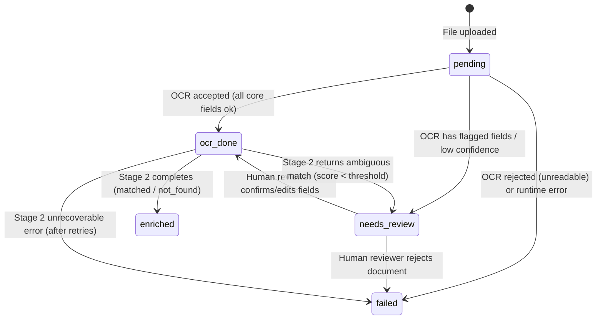

# Handoff Contract: RegOCR (Stage 1) -> Company Info Enrichment (Stage 2)

> **Contract Version:** `0.3`  
> **Companion JSON Schema:** [`schemas/merged_company.schema.json`](../schemas/merged_company.schema.json)

This document defines the exact integration boundary between **Stage 1 (RegOCR: Commercial Registry Extraction)** and **Stage 2 (Teammate's Company-Info / LinkedIn Enrichment)** inside the larger web application.

---

## 1. Identity & Keying Rules

1. **`company_id` (Internal Stable UUID):**
   - Generated by the website backend (UUIDv4, e.g., `"8f4b6c1e-3d52-4a2b-9f1a-7c8d9e0f1a2b"`).
   - **Never derive `company_id` from `register_number`.** Egyptian commercial register numbers (`رقم القيد`) are issued per commercial registry office (`مكتب السجل التجاري`) and are **not guaranteed to be globally unique across governorates/offices** — verify uniqueness rules with domain stakeholders before indexing.
2. **External Business Keys (Composite & National):**
   - Primary national keys (when present on modern extracts): `unified_register_number` (`الرقم الموحد للسجل التجاري`) and `national_entity_number` (`الرقم القومي للمنشأة`).
   - Composite registry key: `(register_number, office)` (and `governorate` as fallback).
   - Tax key: `tax_id` (`رقم البطاقة الضريبية`, format `XXX-XXX-XXX`).
3. **`document_id`:**
   - Stable identifier emitted by RegOCR (`sha256` prefix of file bytes or backend UUID) tying every extraction, review edit, and enrichment snapshot back to the exact uploaded document.

---

## 2. Pipeline Status State Machine

The orchestrator tracks a single `pipeline_status` per uploaded document:



| Status | Meaning | Next Action |
| :--- | :--- | :--- |
| `pending` | Document stored; OCR job queued. | RegOCR worker picks up job. |
| `ocr_done` | OCR succeeded (`accepted`) or human-approved; ready for Stage 2. | Enqueue Stage 2 enrichment job with handoff payload. |
| `needs_review` | Either Stage 1 flagged uncertain fields OR Stage 2 found multiple ambiguous company candidates. | Display in human-review UI; do **not** auto-publish unverified data. |
| `enriched` | Stage 1 and Stage 2 merged according to precedence rules. | Available to downstream website features. |
| `failed` | Document rejected by quality gate (`image_quality_too_low` / missing core fields) or permanent worker failure. | Show `reupload_hint` to user or alert ops. |

---

## 3. Handoff Input Payload (Stage 1 -> Stage 2)

Stage 2 MUST only be invoked once `pipeline_status == "ocr_done"` (or after human review approval). Stage 1 hands off the following lookup payload:

```json
{
  "schema_version": "0.3",
  "company_id": "8f4b6c1e-3d52-4a2b-9f1a-7c8d9e0f1a2b",
  "document_id": "doc_a1b2c3d4e5f67890",
  "lookup_keys": {
    "company_name_ar": "شركة الصفوة للتسويق",
    "company_name_en": null,
    "legal_form": "منشأة فردية",
    "legal_form_code": "sole_proprietorship",
    "activity": "تجارة المواد الغذائية بالجملة",
    "governorate": "القاهرة",
    "address": "108 شارع عبد الله - القاهرة",
    "manager": "محمود طارق القحطاني",
    "register_number": "083778",
    "unified_register_number": "17066 77763 29141",
    "national_entity_number": "07439150008063",
    "issuing_office": "مكتب سجل تجاري طنطا",
    "tax_id": null
  },
  "ocr_confidence_summary": {
    "company_name": 0.91,
    "register_number": 0.94
  }
}
```

### Lookup Key Priority for Stage 2
1. **Primary query:** `company_name_ar` (normalized + transliterated to Latin variants, stripping legal suffixes such as `شركة`, `مؤسسة`, `ذ.م.م`, `ش.م.م`, `LLC`, `S.A.E`).
2. **Disambiguation signals:** `governorate` / `address` (headquarters city), `activity` (industry alignment), `manager` (founder/executive overlap), `issue_date` (founded year $\approx$ issue year).
3. **Never query public social platforms with `tax_id` or `national_entity_number`** — these are sensitive government identifiers and should stay private inside the backend.

---

## 4. Stage 2 Output Payload (Returned to Merger)

Stage 2 returns an `enrichment` object matching `schemas/merged_company.schema.json#/properties/enrichment`:

```json
{
  "source": "teammate_company_enrichment",
  "status": "matched",
  "fetched_at": "2026-11-17T12:10:00Z",
  "match_confidence": 0.87,
  "matched_url": "https://example.com/company/alsafwa-marketing",
  "company_name_en": "Al-Safwa Marketing",
  "company_name_ar": "شركة الصفوة للتسويق",
  "industry": "Food & Beverages",
  "website": "https://alsafwa-marketing.example",
  "headquarters": "Cairo, Egypt",
  "employee_count_range": "11-50",
  "founded_year": 2018,
  "description": "Wholesale food distribution and marketing in Egypt.",
  "candidates": [
    {
      "name": "Al-Safwa Marketing",
      "url": "https://example.com/company/alsafwa-marketing",
      "location": "Cairo, Egypt",
      "industry": "Food & Beverages",
      "match_score": 0.87
    }
  ],
  "error": null
}
```

### Handling Zero or Multiple Candidates
- **Zero candidates (`status: "not_found"`):** Merge still succeeds (`pipeline_status: "enriched"`), keeping all OCR fields with `provenance: "ocr"` and `enrichment.status: "not_found"`.
- **Single strong match (`match_confidence >= 0.80` and gap to #2 candidate `>= 0.15`):** Auto-merge (`status: "matched"`).
- **Multiple close candidates or borderline match (`0.55 <= match_confidence < 0.80` or top-2 gap `< 0.15`):** Return top 3 in `candidates[]`, set `enrichment.status = "ambiguous"`, and transition `pipeline_status` to `needs_review` so a human picks the right profile (or "None").

---

## 5. Merge Precedence & Conflict Resolution Rules

Every merged field carries `{ value, provenance, confidence, verified_by_human }`:

| Field Domain | Authoritative Source | Rule on Conflict |
| :--- | :--- | :--- |
| **Legal / Statutory Fields** (`company_name_ar`, `legal_form`, `register_number`, `unified_register_number`, `national_entity_number`, `tax_id`, `issue_date`, `expiry_date`, `capital`, `manager`, `office`) | **`ocr`** (or `human_override`) | Always prefer `ocr` (statutory government record). Log discrepancy in `merged.conflicts[]` with `resolution: "prefer_ocr"`. |
| **Registered Address vs HQ** (`address` vs `headquarters`) | Keep both separately; `address` = `ocr`, `headquarters` = `enrichment` | If governorate/city disagrees (e.g., OCR says Tanta, enrichment says Dubai), append a conflict with `resolution: "human_review"` and lower `match_confidence` because it may indicate a wrong entity match. |
| **Digital / Public Profile Fields** (`company_name_en`, `website`, `industry`, `employee_count_range`, `description`, `matched_url`) | **`enrichment`** | Accept from `enrichment` only when `enrichment.status == "matched"`. |
| **Human Overrides** | **`human_override`** | Always wins over both `ocr` and `enrichment`; sets `verified_by_human: true`. |

### Consistent Worked Merged Example

```json
{
  "schema_version": "0.3",
  "company_id": "8f4b6c1e-3d52-4a2b-9f1a-7c8d9e0f1a2b",
  "document_id": "doc_a1b2c3d4e5f67890",
  "pipeline_status": "enriched",
  "updated_at": "2026-11-17T12:10:05Z",
  "external_keys": {
    "unified_register_number": "17066 77763 29141",
    "national_entity_number": "07439150008063",
    "register_number": "083778",
    "issuing_office": "مكتب سجل تجاري طنطا",
    "tax_id": null
  },
  "ocr": {
    "schema_version": "0.3",
    "submission_id": "sub_1794913502_egypt_00001",
    "document_id": "doc_a1b2c3d4e5f67890",
    "status": "accepted",
    "fields": {
      "company_name": { "value": "شركة الصفوة للتسويق", "confidence": 0.91, "status": "ok" },
      "register_number": { "value": "083778", "confidence": 0.94, "status": "ok" },
      "unified_register_number": { "value": "17066 77763 29141", "confidence": 0.93, "status": "ok" },
      "capital": { "value": 226000.0, "unit": "EGP", "confidence": 0.92, "status": "ok" }
    }
  },
  "enrichment": {
    "source": "teammate_company_enrichment",
    "status": "matched",
    "fetched_at": "2026-11-17T12:10:00Z",
    "match_confidence": 0.87,
    "matched_url": "https://example.com/company/alsafwa-marketing",
    "company_name_en": "Al-Safwa Marketing",
    "company_name_ar": "شركة الصفوة للتسويق",
    "industry": "Food & Beverages",
    "website": "https://alsafwa-marketing.example",
    "headquarters": "Cairo, Egypt",
    "employee_count_range": "11-50",
    "founded_year": 2018,
    "description": "Wholesale food distribution and marketing in Egypt.",
    "candidates": [],
    "error": null
  },
  "merged": {
    "fields": {
      "company_name_ar": { "value": "شركة الصفوة للتسويق", "provenance": "ocr", "confidence": 0.91, "verified_by_human": false },
      "company_name_en": { "value": "Al-Safwa Marketing", "provenance": "enrichment", "confidence": 0.87, "verified_by_human": false },
      "register_number": { "value": "083778", "provenance": "ocr", "confidence": 0.94, "verified_by_human": false },
      "capital_egp": { "value": 226000.0, "provenance": "ocr", "confidence": 0.92, "verified_by_human": false },
      "industry": { "value": "Food & Beverages", "provenance": "enrichment", "confidence": 0.87, "verified_by_human": false }
    },
    "conflicts": [],
    "needs_review": false
  }
}
```
