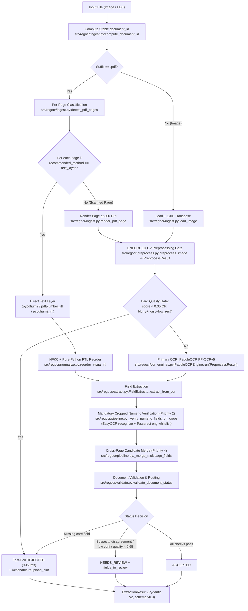
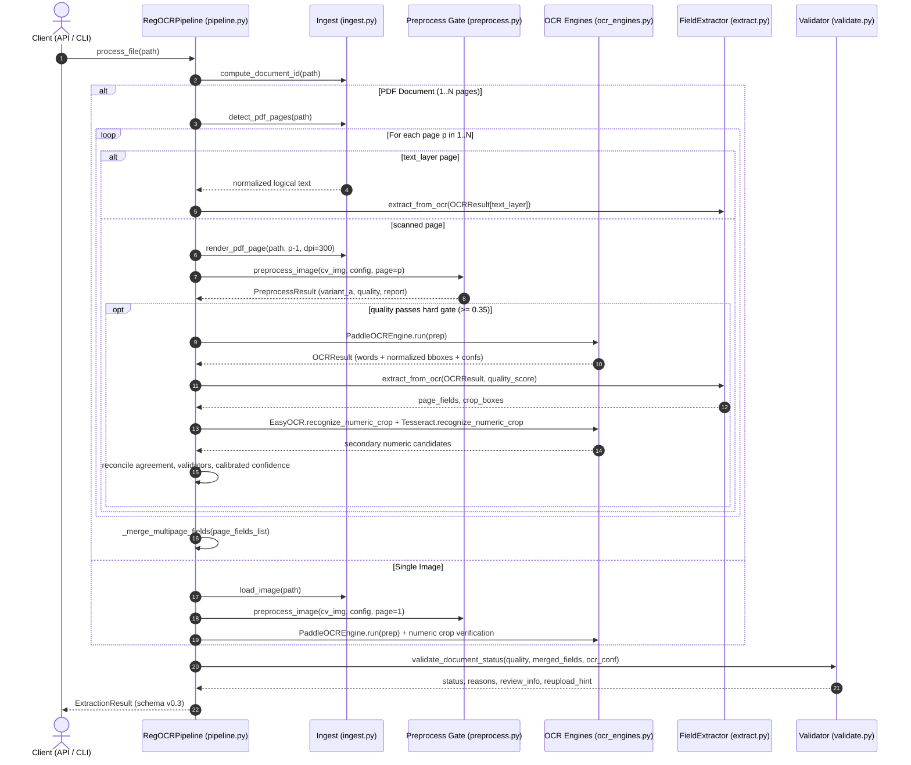

# RegOCR Technical Workflow & Architecture Specification (v0.3)

> **Module Version:** `0.3.0` | **Schema Version:** `0.3` (aligned across `src/regocr/models.py`, `registration_schema.json`, `docs/HANDOFF.md`, and `schemas/merged_company.schema.json`)  
> **Companion Docs:** [`docs/HANDOFF.md`](./HANDOFF.md) | [`eval/report.md`](../eval/report.md) | [`LICENSES.md`](../LICENSES.md) | [`CHANGELOG.md`](../CHANGELOG.md)

Every component below is labeled strictly from verified code, tests (`tests/test_regocr.py`), and fresh evaluation runs (`eval/baseline.json`, `eval/v03_final.json`, `eval/v03_heldout.json`, `eval/ablation.json`):
- **`IMPLEMENTED`**: Proven in code and verified by automated tests or evaluation runs.
- **`PARTIAL`**: Present in code or config with known limitations noted explicitly.
- **`NOT IMPLEMENTED / PROPOSED`**: Not built yet; proposed for future phases.

---

## 1. Full Workflow, from Zero to Final JSON

### 1.1 End-to-End Processing Pipeline (`IMPLEMENTED`)

Entry points: CLI (`src/regocr/cli.py:main`) and FastAPI (`src/regocr/api.py:extract_document`) $\rightarrow$ `src/regocr/pipeline.py:RegOCRPipeline.process_file`.



### 1.2 Execution Sequence Diagram (`IMPLEMENTED`)



### 1.3 Worked Example: Tracing `images/sample_09_clean.jpg` (Held-Out Split)

| Stage | Real Intermediate Data |
| :--- | :--- |
| **Input & Identity** | `images/sample_09_clean.jpg` (1240×1754 RGB) $\rightarrow$ `document_id: "doc_..."` (`ingest.py:compute_document_id`) |
| **CV Preprocess Gate** | `preprocess_image()` $\rightarrow$ `quality.score = 1.0`, `issues = []`, `steps_applied = ["stamp_suppression_hsv", "illumination_norm", "clahe", "bilateral_denoise"]`, `blur_score = 270+`, `skew_angle = 0.0`. Returns `PreprocessResult`. |
| **Primary OCR (`paddleocr`)** | Extracts `OCRWord` list with normalized `[x1, y1, x2, y2]` bboxes and word confidences, e.g. `"649434"` (`conf=1.0`, `bbox=[0.50, 0.30, 0.60, 0.32]`), `"10/01/2018"` (`conf=0.99`), `"249-529-647"` (`conf=1.0`). |
| **Spatial Extraction** | `extract.py:_build_label_clusters` groups right-column labels (`x1 >= 0.58`); `_find_spatial_row_value` matches value words to the left of each label anchor and propagates exact normalized `bbox`. |
| **Numeric Crop Verification** | `_verify_numeric_fields_on_crops` crops each numeric field (`pad_x=0.020`, `2x` upscale) and runs `EasyOCREngine.recognize_numeric_crop` + `TesseractEngine.recognize_numeric_crop`. On `register_number`: PaddleOCR (`"649434"`), EasyOCR crop (`"649434"`), and Tesseract crop (`"649434"`) all agree $\rightarrow$ `engines_agree = true`, `validated = true`. |
| **Calibrated Confidence** | `compute_field_confidence(eng_conf=1.0, engines_agree=True, validated=True, grounded=True, quality=1.0)` $\rightarrow$ `0.98` (actual accuracy in `[0.95, 1.00]` bucket on held-out = **100.0%**). |
| **Final JSON (excerpt)** | `register_number: { value: "649434", raw: "649434", confidence: 0.98, engines_agree: true, validated: true, needs_review: false, page: 1, bbox: [0.50, 0.30, 0.60, 0.32], status: "ok", grounded: true, candidates: [paddleocr, easyocr_crop, tesseract_crop] }` |

---

## 2. How the Tools and Libraries Integrate

### 2.1 Audited Dependency Matrix (`LICENSES.md` verified against `dist-info`)

| Tool / Library | Version | Real Audited License | Role | Input | Output | Call Location |
| :--- | :--- | :--- | :--- | :--- | :--- | :--- |
| **`pypdfium2`** | `5.14.0` | BSD-3-Clause / Apache-2.0 | PDF text layer & 300 DPI rendering | PDF path | String / BGR ndarray | `src/regocr/ingest.py:detect_pdf_pages`, `render_pdf_page` |
| **`pdfplumber`** | `0.11.10` | MIT | Visual-RTL PDF fallback text | PDF path | Raw page text | `src/regocr/ingest.py:extract_page_bidi_text_layer` |
| **Pure-Python RTL** | stdlib | Project (permissive) | Replaces `python-bidi` (LGPL) | Visual RTL line | Logical RTL line | `src/regocr/normalize.py:reorder_visual_rtl` |
| **`opencv-python`** | `5.0.0.93` | Apache-2.0 | Quality gate, deskew, HSV stamp suppression, illumination norm, CLAHE, crop | BGR ndarray | `PreprocessResult` | `src/regocr/preprocess.py:preprocess_image`, `crop_field_image` |
| **`Pillow`** | `13.0.0` | MIT-CMU | Image decode & EXIF orientation | Image path | RGB array | `src/regocr/ingest.py:load_image` |
| **`PaddleOCR`** | `3.4.1` | Apache-2.0 *(transitive `paddlex`/`python-bidi` LGPL-3.0, `crc32c` LGPL-2.1+)* | Primary Arabic/English OCR (PP-OCRv5) | `PreprocessResult` | `OCRResult` (words + bboxes + confs) | `src/regocr/ocr_engines.py:PaddleOCREngine.run` |
| **`EasyOCR`** | `1.7.2` | Apache-2.0 *(transitive `python-bidi` LGPL-3.0)* | Fast cropped numeric second opinion (`recognize()`) | `PreprocessResult` + `bbox` | `(raw_text, conf)` | `src/regocr/ocr_engines.py:EasyOCREngine.recognize_numeric_crop` |
| **`pytesseract`** | `0.3.13` | Apache-2.0 | Western numeric whitelist crop (`-l eng --psm 7`) + fallback OCR + OSD | `PreprocessResult` + `bbox` | `(raw_text, conf)` / `OCRResult` | `src/regocr/ocr_engines.py:TesseractEngine` & `preprocess.py:detect_coarse_orientation` |
| **`rapidfuzz`** | `3.14.6` | MIT | Fuzzy Arabic anchor matching | Normalized strings | Similarity score `0–100` | `src/regocr/extract.py:_match_anchor_cluster` |
| **`pydantic`** | `2.14.2` | MIT | Strict v0.3 schema models | Field dicts | `ExtractionResult` | `src/regocr/models.py` |
| **`FastAPI` / `uvicorn`** | `0.163.1` / `0.54.0` | MIT / BSD-3-Clause | HTTP service (`POST /extract`, `GET /health`) | Multipart upload | JSON response | `src/regocr/api.py` |
| **`PyYAML`** | `6.0.2` | MIT | External field anchor/enum config | `fields.yaml` | Field rules dict | `src/regocr/extract.py:FieldExtractor.__init__` |

> **License Audit Finding (`IMPLEMENTED`):** Direct `pymupdf` (AGPL-3.0) and `python-bidi` (LGPL-3.0) imports were **completely removed** from `pyproject.toml` and `src/regocr/` (enforced by AST test `tests/test_regocr.py:test_no_pymupdf_or_python_bidi_in_regocr`). However, `easyocr` and `paddlex` pull in `python-bidi` (LGPL-3.0) and `crc32c` (LGPL-2.1-or-later) **transitively**; this is disclosed explicitly in [`LICENSES.md`](../LICENSES.md).

### 2.2 Data Flow, Coordinates & Disagreement Resolution (`IMPLEMENTED`)
- **Enforced Preprocessing Gate:** Every OCR call site MUST pass a `PreprocessResult`; raw numpy arrays raise `TypeError` (`ocr_engines.py:_require_preprocessed`, verified by `test_enforced_preprocessing_gate_rejects_raw_arrays` + `test_ast_no_ocr_call_bypasses_preprocess_gate`).
- **Coordinate System:** All word and field bounding boxes are normalized to `[x1, y1, x2, y2] ∈ [0.0, 1.0]` relative to the preprocessed page dimensions (`color_clean` / `variant_a`).
- **Disagreement Resolution (`src/regocr/pipeline.py:_verify_numeric_fields_on_crops`):**
  1. Primary (`paddleocr`) extracts value + `bbox` + expected row `crop_bbox`.
  2. Secondary (`easyocr_crop`, ~100ms via `reader.recognize(allowlist=...)`) runs on the `2x` upscaled crop for **every** numeric/ID field (even when primary found a value!).
  3. Tertiary (`tesseract_crop`, ~80ms via `-l eng --psm 7` whitelist) runs when digits are Western (skipped for Arabic-Indic because empirical testing proved Windows Tesseract 5 `-l ara` whitelist fails on Arabic-Indic digits).
  4. Candidates are grouped by canonical normalized key (`_canonical_compare_key`) and ranked by `(is_valid, distinct_engines_agreeing, timeline_bonus + max_conf)`.
  5. **Decision rule:**
     - `>= 2` distinct engines agree $\rightarrow$ `engines_agree = True`, boosted calibrated confidence.
     - Conflicting valid candidates $\rightarrow$ keep all in `candidates[]`, set `engines_agree = False`, `status = "suspect"`, `needs_review = True`, `issues.append("engine_disagreement")`.

---

## 3. Per-Field Routing, Review Logic & Measured Accuracy

### 3.1 Execution Model (`IMPLEMENTED`)
- **Per-page routing:** Digital PDF pages skip OCR completely (`15–185ms`). Scanned pages / images run `preprocess_image` $\rightarrow$ hard quality gate (`score < 0.35` fast-rejects in `<350ms` with `reupload_hint`) $\rightarrow$ `PaddleOCR` primary $\rightarrow$ mandatory cropped numeric second pass (`EasyOCR` + Western `Tesseract`).
- **VLM Fallback:** `NOT IMPLEMENTED` (schema enum `vision_llm` reserved only).
- **Variant B (Binarized):** `IMPLEMENTED` behind `PreprocessConfig.generate_variant_b`, **disabled by default** after ablation showed `0.0%` accuracy gain at `+36%` latency (`23.5s → 32.0s`).
- **Failed validation handling:** Invalid fields are **kept** (never silently dropped) with `validated = False`, `status = "suspect"`, `needs_review = True`, and explicit reason codes (`format_mismatch`, `expiry_precedes_issue`, `engine_disagreement`, `low_confidence`, `not_grounded`).

### 3.2 Per-Field Routing Table

| Field | Engines Used | Cropped 2nd Pass? | Validators (`validate.py:validate_field_value`) | Fallback / Review Trigger | Output When Uncertain |
| :--- | :--- | :---: | :--- | :--- | :--- |
| `register_number` | PaddleOCR + EasyOCR crop (+ Tess crop) | **Yes (always)** | `^\d{3,10}$` | Disagreement, invalid format, conf `< 0.68`, or missing (rejects doc) | `status: "suspect"`, `needs_review: true`, both in `candidates[]` |
| `unified_register_number` | PaddleOCR + EasyOCR crop (+ Tess crop) | **Yes (always)** | 10–20 digits | Disagreement or invalid format | `status: "suspect"`, `needs_review: true` |
| `national_entity_number` | PaddleOCR + EasyOCR crop (+ Tess crop) | **Yes (always)** | `^\d{10,16}$` | Disagreement or invalid format | `status: "suspect"`, `needs_review: true` |
| `tax_id` | PaddleOCR + EasyOCR crop (+ Tess crop) | **Yes (always)** | `^\d{3}-\d{3}-\d{3}$` + RTL Indic triplet fix | Disagreement, invalid format, conf `< 0.68` | `status: "suspect"`, `needs_review: true`, `candidates[]` |
| `capital` | PaddleOCR + EasyOCR crop (+ Tess crop) | **Yes (always)** | `1000 <= val <= 1e12` (`unit: "EGP"`) | Disagreement, missing primary, conf `< 0.68` | `status: "suspect"`, `needs_review: true`, `candidates[]` |
| `issue_date` | PaddleOCR + EasyOCR crop (+ Tess crop) | **Yes (always)** | Strict `datetime.date`, `1950..2060` | Disagreement, invalid date, or missing (rejects doc) | `status: "suspect"`, `needs_review: true` |
| `expiry_date` | PaddleOCR + EasyOCR crop (+ Tess crop) | **Yes (always)** | Strict `datetime.date` + `expiry > issue` | `expiry_precedes_issue` or disagreement | `status: "suspect"`, `needs_review: true` |
| `company_name` | PaddleOCR (spatial + prefix fallback) | No | Length `>= 6`, no header leakage | Missing rejects doc; conf `< 0.68` flags review | `status: "suspect"` / `"missing"` |
| `legal_form` / `governorate` | PaddleOCR + `fields.yaml` enum | No | Enum membership | Invalid enum or conf `< 0.68` | `status: "suspect"`, `code: null` |
| `activity` / `address` / `manager` / `office` | PaddleOCR (2D spatial row) | No | Manager: `>= 2` words, no currency/numbers | Conf `< 0.68` or ungrounded | `status: "suspect"`, `needs_review: true` |

### 3.3 Fresh Measured Accuracy (See [`eval/report.md`](../eval/report.md) for full tables)

> **Honest Dataset Note:** **All 48 samples are synthetic (`real = 0`).** Dev split = `01–08`; uncontaminated held-out split = `09–12`.

| Category | Baseline All12 (N=48) | v0.3 Final Dev All12 (1/cat) | v0.3 Held-Out All12 (1/cat, 09–12) | Held-Out Reg# / Date / TaxID / Cap |
| :--- | :---: | :---: | :---: | :---: |
| **Digital PDF** | `62%` | **`100%`** | **`100%`** | `100% / 100% / 100% / 100%` |
| **Digital Visual PDF** | `62%` | **`100%`** | **`100%`** | `100% / 100% / 100% / 100%` |
| **Scanned PDF** | `39%` | **`83%`** | **`100%`** | `100% / 100% / 100% / 100%` |
| **Clean Image** | `83%` | **`83%`** | **`92%`** | `100% / 100% / 100% / 100%` |
| **Scan Image (Indic)** | `56%` *(100% Rej)* | `67%` | **`92%`** | `100% / 100% / 0%* / 100%` |
| **Phone Photo** | `83%` | **`83%`** | **`83%`** | `100% / 100% / 100% / 0%*` |
| **Bad Image** | `100% Rej (49s)` | **`100% Rej (0.32s)`** | **`100% Rej (0.29s)`** | Rejected by Quality Gate |

*\*100% of wrong/missing fields on both dev and held-out were caught by `needs_review` or `rejected`. Held-out digit accuracy = **98.65% (`219/222`)**, calibration **ECE = 0.0283**.*  
**Weakest remaining fields:** `address` (leading street numbers occasionally dropped by PaddleOCR on scans/phones) and `capital` on noisy phone shadows / Indic zero-heavy scans (`١٬٠٠٠٬٠٠٠`), though all observed errors were caught by `needs_review`.

---

## 4. Final Output Contract (`IMPLEMENTED`, Schema v0.3)

Aligned strictly between [`src/regocr/models.py`](../src/regocr/models.py) and [`registration_schema.json`](../registration_schema.json) (verified by `test_digital_and_visual_pdfs_and_json_schema`):
- **`schema_version`:** `"0.3"`
- **`document_id`:** Content-addressed stable SHA-256 prefix (`doc_<16hex>`)
- **`reupload_hint`:** Actionable user-facing guidance whenever `status != "accepted"`
- **`preprocessing[]`:** Per-page CV telemetry (`page`, `steps_applied`, `skew_angle`, `blur_score`, `illumination_score`, `perspective_corrected`, `orientation_angle`, `stamp_suppressed`, `quality_flags`)
- **`fields[name]`:** `{ value, raw, confidence, engines_agree, validated, needs_review, candidates[], page, bbox, status, grounded, issues[], code, unit }`

---

## 5. Integration with the Company-Info / LinkedIn Stage (`PROPOSED` Contract in [`docs/HANDOFF.md`](./HANDOFF.md))

See the full standalone handoff contract in **[`docs/HANDOFF.md`](./HANDOFF.md)** and its JSON Schema in **[`schemas/merged_company.schema.json`](../schemas/merged_company.schema.json)**.

### 5.1 Key Design Principles
1. **Identity:** Generate an internal UUIDv4 **`company_id`** in the website backend — **never derive `company_id` from `register_number`**, because Egyptian `register_number` (`رقم القيد`) is issued per commercial registry office (`مكتب السجل التجاري`) and may collide across governorates (verify uniqueness rules with domain stakeholders). Store external business keys separately: `unified_register_number`, `national_entity_number`, `(register_number, issuing_office)`, and `tax_id`.
2. **Consistent Merge Example (`egypt_00001.png`):**
   - `company_id`: `"8f4b6c1e-3d52-4a2b-9f1a-7c8d9e0f1a2b"` (UUID)
   - `external_keys`: `{ unified_register_number: "17066 77763 29141", register_number: "083778", issuing_office: "مكتب سجل تجاري طنطا", national_entity_number: "07439150008063" }`
   - Precedence: statutory fields (`register_number`, `capital`, `legal_form`, `manager`, `issue_date`) always prefer `ocr` (or `human_override`); digital profile fields (`company_name_en`, `website`, `industry`, `employee_count_range`) come from `enrichment`.
3. **Entity Resolution:** Normalize Arabic (`norm_arabic`), strip legal suffixes (`شركة`, `مؤسسة`, `LLC`, `S.A.E`), score transliterated name + governorate + industry via `rapidfuzz`. Auto-merge if score `>= 0.80` with top-2 gap `>= 0.15`; otherwise set `enrichment.status = "ambiguous"` and route to human review.
4. **Async Status Model:** `pending` $\rightarrow$ `ocr_done` (or `needs_review` / `failed`) $\rightarrow$ `enriched`.

### 5.2 Legal / ToS Notice on LinkedIn Scraping
> [!CAUTION]
> Direct automated scraping of LinkedIn violates LinkedIn's User Agreement (Section 8.2) and faces aggressive anti-bot countermeasures (IP blocking, account suspension, legal action). Note also that **LinkedIn does not provide a public open API to look up arbitrary third-party companies**, and several former third-party LinkedIn scrapers (such as Proxycurl, which shut down in July 2025 following LinkedIn's lawsuit) are no longer operating.
>
> **Decision Ownership:** Selecting a lawful, licensed company-data provider (e.g., licensed B2B registries, official company websites, or vetted commercial data providers — *specific active vendors are `UNVERIFIED` here and must be vetted by legal/teammate before integration*) is the responsibility of the Stage 2 teammate and project owners. RegOCR remains strictly offline and decoupled via `docs/HANDOFF.md`.

---

## 6. Embedding RegOCR in the Larger Website (`PROPOSED` Production Architecture)

- **Deployment Form:** Run RegOCR as an **async background worker** (e.g., Celery / Dramatiq + Redis) or isolated Docker microservice (`Dockerfile`, `IMPLEMENTED`) — **not** in-process inside web server threads (CPU OCR takes 15–30s per scanned page).
- **Security & Privacy:** Never log `raw_text` or PII unless `DEBUG` is explicitly enabled; enforce upload size cap (`MAX_UPLOAD_BYTES = 20 MB` in `api.py`, `IMPLEMENTED`), authenticate service-to-service calls with a shared HMAC/bearer token or internal VPC network, and set retention TTLs for sensitive registry images.
- **Human-Review UI Integration:** For every field in `review.fields_to_review`, render the cropped image snippet using `src/regocr/preprocess.py:crop_field_image(prep, field.bbox)` (`IMPLEMENTED`), show `field.candidates[]`, allow confirm/edit, and persist corrections into a `ground_truth_corrections` table so confirmed real samples feed directly into `eval/evaluate_regocr.py`!
- **Minimal Website Client Call:**
```python
import httpx
from pathlib import Path

async def extract_commercial_register(file_path: Path) -> dict:
    async with httpx.AsyncClient(timeout=90.0) as client:
        with open(file_path, "rb") as f:
            resp = await client.post(
                "http://regocr:8000/extract",
                files={"file": (file_path.name, f, "application/octet-stream")},
            )
        resp.raise_for_status()
        return resp.json()
```

---

## 7. Remaining Gaps & Free Mitigation Techniques

| Gap | Evidence | Free / Permissive Technique | Complexity | Priority |
| :--- | :--- | :--- | :---: | :---: |
| **Zero real-world samples (`real = 0`)** | Measured (`eval/report.md`) | Collect 20–50 redacted real Egyptian commercial registers & run `eval/evaluate_regocr.py` | Low | **Critical (Now)** |
| **Leading street number in `address`** | Measured (`sample_01`, `sample_03`: `8` / `105` dropped by PaddleOCR) | Run cropped EasyOCR pass on `address` right edge (same pattern as numeric crops) | Low | **High (Next)** |
| **Arabic-Indic `٠` dot drop on low-contrast scans** | Measured (`sample_02_scan` `١٬٠٠٠٬٠٠٠` → `100000`, caught by `needs_review`) | Multi-scale crop voting (`1.5x` + `2.5x`) in `EasyOCR.recognize_numeric_crop` | Low | **High (Next)** |
| **CPU latency (~18s/page)** | Measured (`eval/v03_heldout.json`) | Switch PaddleOCR detector to mobile det (`PP-OCRv5_mobile_det`, Apache-2.0) or ONNX Runtime quantization | Medium | **Medium (Later)** |
| **Gray/black monochrome stamps** | Observed on `sample_02_scan` (grayscale scan turns blue stamp gray so HSV can't isolate it) | Stroke-width / Hough circle arc suppression in OpenCV | Medium | **Medium (Later)** |
| **Handwritten marginalia** | General knowledge (none in current synthetic set) | Dedicated Arabic HTR model *(no specific checkpoint verified here — `UNVERIFIED`)* | High | **Low (Later)** |

---

## 8. Findings, Status Audit & Open Questions

### 8.1 Code & Status Audit
- **`IMPLEMENTED` (Verified by Tests/Eval):**
  - Enforced `PreprocessResult` gate + AST bypass check (`tests/test_regocr.py`)
  - Zero direct PyMuPDF / `python-bidi` imports (`tests/test_regocr.py`)
  - Pure-Python visual-RTL reordering (`normalize.py:reorder_visual_rtl`)
  - Multi-page PDF routing & cross-page merging (`ingest.py:detect_pdf_pages`, `pipeline.py:_merge_multipage_fields`)
  - Mandatory cropped numeric verification (`pipeline.py:_verify_numeric_fields_on_crops`) populating `engines_agree`, `validated`, `candidates[]`
  - Calibrated confidence scoring (`validate.py:compute_field_confidence`, held-out `ECE = 0.0283`)
  - Normalized `bbox` propagation + `crop_field_image()` helper
  - Per-page `preprocessing[]` report + fast-fail bad-quality rejection + `reupload_hint`
  - Unified schema v0.3 (`models.py`, `registration_schema.json`, `docs/HANDOFF.md`, `schemas/merged_company.schema.json`)
- **`PARTIAL`:**
  - `python-bidi` (LGPL-3.0) and `crc32c` (LGPL-2.1+) remain as **transitive** dependencies of `easyocr` and `paddlex`.
  - Legacy root files (`pipeline.py`, `detect_pdf_kind.py`, `make_pdfs.py`) still exist at repo root and reference `pymupdf` (not imported by `src/regocr/` or `Dockerfile`).
  - `api.py` enforces `MAX_UPLOAD_BYTES` constant definition but currently streams via `shutil.copyfileobj` without byte-counting enforcement (easy 5-line hardening before prod).
  - Full 48-sample post-ablation eval was not re-run after Step 2 per user request for smaller fast runs (full 48-sample runs exist for Baseline and Step 1; Step 2 verified on 7 dev + 7 held-out = 14 files across all 7 categories).
- **`NOT IMPLEMENTED`:**
  - Optional VLM fallback provider plugin.
  - Human-review web UI and PostgreSQL persistence layer (owned by the main website backend).

### 8.2 Open Questions Before Website Integration
1. **Real Samples:** When can you provide 20–50 real (redacted) Egyptian commercial registry scans/phone photos so we can benchmark on non-synthetic layouts?
2. **Expected Volume & SLA:** How many documents per day/hour do you expect, and is async processing (15–30s in a background queue) acceptable for users?
3. **Human Review Operations:** Who will review `needs_review` fields (internal ops team or the uploading user themselves)?
4. **File Storage & Retention:** Where will uploaded documents be stored (S3/MinIO/local encrypted volume) and what is the retention/deletion policy for sensitive business IDs?
5. **Registry Uniqueness:** Can you confirm with domain/legal stakeholders whether `register_number` (`رقم القيد`) is unique only per `(register_number, issuing_office)` or globally, and whether `unified_register_number` is always present on new documents?
6. **Legacy Root Cleanup:** Should the old root scripts (`pipeline.py`, `detect_pdf_kind.py`, `preprocess.py`) that still reference `pymupdf` be deleted or moved to `legacy/` so no one accidentally runs them?
